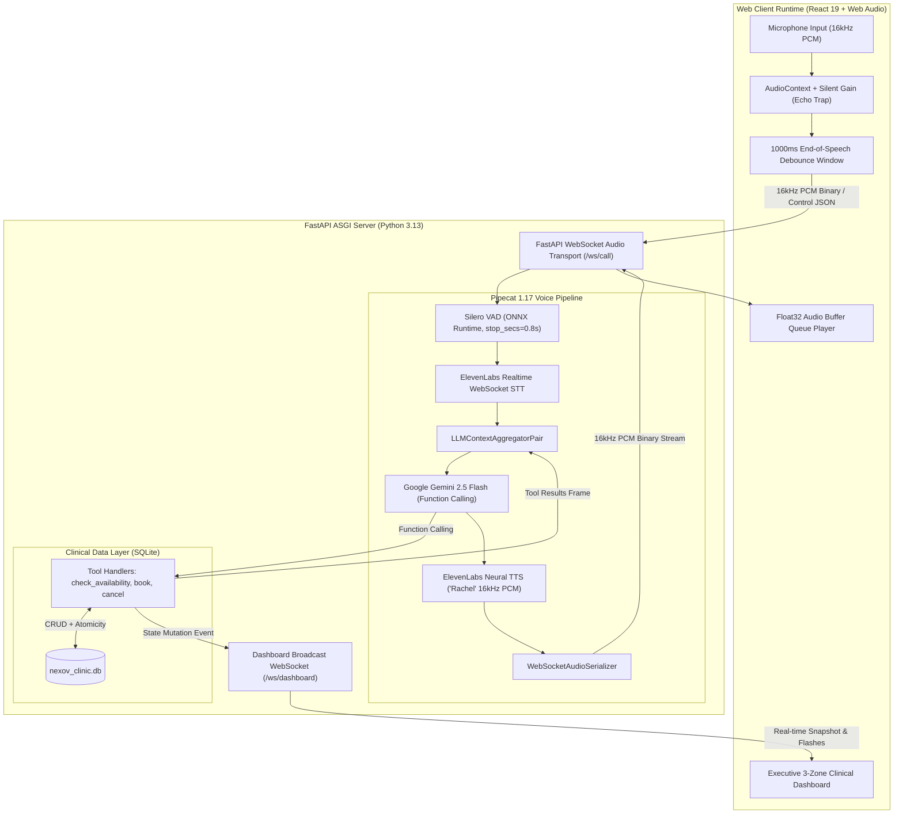
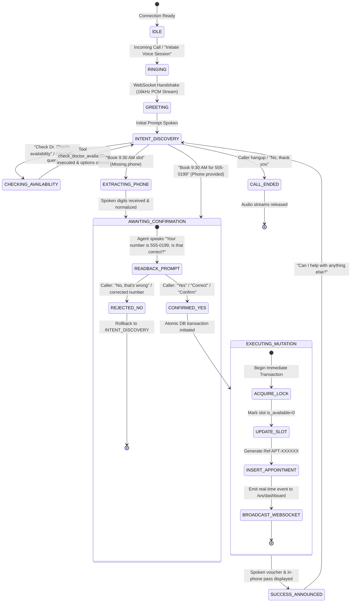

# Nexov Health — Executive Clinical Voice AI Booking Suite

**Candidate:** Shamit Bundela  
**Role:** Forward Deployed Engineer (FDE) / SDE Internship  
**Submission:** Round 1 Assignment — Voice AI Doctor Appointment Booking Agent  
**Frameworks:** Pipecat 1.17 • ElevenLabs STT/TTS • Google Gemini 2.5 Flash • Silero VAD (ONNX) • FastAPI • React + Tailwind CSS  
**Repository:** [https://github.com/Shamit248/NexovAI_voice_agent](https://github.com/Shamit248/NexovAI_voice_agent)

---

## 🏥 Executive Summary

This repository contains the complete implementation of **Nexa**, an autonomous clinical voice concierge and real-time operations dispatch dashboard engineered for Nexov Health. Nexa conducts full-duplex, low-latency telephone conversations with callers to check physician schedules, book clinic appointments, and cancel existing bookings.

### Strict Assignment Compliance & Clinical Rules
1. **Zero Login / OTP Overhead:** The patient is identified exclusively by their spoken telephone digits.
2. **Mandatory Confirmation Readback:** Before committing any state mutation to the database (`book_appointment` or `cancel_appointment`), Nexa repeats the phone number back to the caller and requires verbal confirmation.
3. **End-to-End Multitask Handling:** Callers can query availability across 5 specialties, book appointments, and cancel in a single continuous telephone session.
4. **Instantaneous Real-Time Synchronization:** A light luxury operations dashboard reflects schedule locks, appointment ledger mutations, and audio waveforms with zero page reloads via full-duplex WebSockets.

---

## 🏛️ System Architecture

### 1. End-to-End Pipeline Data Flow



---

### 2. Conversational State Machine & Clinical Verification Flow

Nexa operates on a deterministic clinical state machine designed to eliminate hallucinations, enforce phone number verification, and guarantee atomic database transactions.

#### State Machine Architecture



#### End-to-End Sequence & Real-Time Sync

```mermaid
sequenceDiagram
    autonumber
    actor Patient as Caller (Telephone)
    participant Agent as Nexa Concierge (Voice Agent)
    participant Tool as Clinical Tool Handlers
    participant DB as SQLite (nexov_clinic.db)
    participant Dash as Executive Dashboard

    Patient->>Agent: "Hi, what slots are available for Cardiology?"
    Agent->>Tool: check_doctor_availability(specialty="Cardiology")
    Tool->>DB: SELECT * FROM slots WHERE doctor="Dr. Sarah Chen" AND is_available=1
    DB-->>Tool: [09:30 AM, 11:00 AM, 02:30 PM]
    Tool-->>Agent: Available slot list
    Agent-->>Patient: "Dr. Sarah Chen has openings today at 9:30 AM and 11:00 AM. Would one work?"

    Patient->>Agent: "Book 9:30 AM for phone 555-0199"
    Note over Agent: MANDATORY CONFIRMATION RULE (Zero DB writes permitted yet)
    Agent-->>Patient: "Just to make sure I have that recorded correctly, your phone number is 555-0199, is that correct?"
    
    Patient->>Agent: "Yes, that is correct."
    Agent->>Tool: book_appointment(phone="555-0199", doctor="Dr. Sarah Chen", slot="09:30 AM")
    Tool->>DB: BEGIN IMMEDIATE; UPDATE slots SET is_available=0; INSERT INTO appointments; COMMIT;
    DB-->>Tool: Success (Ref: APT-261127-9007)
    Tool->>Dash: broadcast("appointment_booked", appointment)
    Dash-->>Dash: Flash row in warm amber, lock 9:30 AM slot, update KPI counter
    Tool-->>Agent: Confirmation Details
    Agent-->>Patient: "Your appointment is confirmed under reference APT-261127-9007! Can I help with anything else?"
```

#### Deterministic State Transition & Guard Matrix

| Current State | Spoken Input / Event | Guard Condition | Next State | System Actions & Side Effects |
| :--- | :--- | :--- | :--- | :--- |
| **`IDLE`** | Click *"Initiate Voice Session"* | WebSocket connected | **`RINGING`** | Synthesize 440Hz+480Hz telephony ring cadence via Web Audio API. |
| **`RINGING`** | Handshake finalized | AudioContext active | **`GREETING`** | Play connected chime; send initial greeting speech packet. |
| **`GREETING`** | Greeting audio finishes | Speech synthesis ended | **`INTENT_DISCOVERY`** | Activate `Silero VAD` & 1000ms end-of-speech debounce window. |
| **`INTENT_DISCOVERY`** | *"Check slots for Cardiology"* | Specialty identified | **`CHECKING_AVAILABILITY`** | Execute `check_doctor_availability`; return 2 available morning/afternoon slots. |
| **`INTENT_DISCOVERY`** | *"Book 9:30 AM for 555-0199"* | Slot + Phone parsed | **`AWAITING_CONFIRMATION`** | Normalize phone to `555-0199`; cache booking intent in memory. **DB write locked.** |
| **`INTENT_DISCOVERY`** | *"Book 9:30 AM with Dr. Chen"* | Phone number missing | **`EXTRACTING_PHONE`** | Prompt caller: *"What phone number should I put on the reservation?"* |
| **`EXTRACTING_PHONE`** | Caller speaks digits | $\ge 7$ digits extracted | **`AWAITING_CONFIRMATION`** | Format as `XXX-XXXX`; transition to mandatory readback confirmation. |
| **`AWAITING_CONFIRMATION`**| *"Yes" / "Correct" / "Confirm"* | Verbal affirmation | **`EXECUTING_MUTATION`** | Execute `book_appointment`; commit atomic DB transaction; broadcast WebSocket update. |
| **`AWAITING_CONFIRMATION`**| *"No, that's wrong" / "Cancel"* | Affirmation absent | **`INTENT_DISCOVERY`** | Purge cached pending data; prompt caller to re-enter number. **Zero DB writes.** |
| **`INTENT_DISCOVERY`** | *"Cancel my appointment for 555-0199"*| Cancellation intent | **`AWAITING_CONFIRMATION`** | Readback: *"Just to confirm, you want to cancel the booking for 555-0199?"* |
| **`AWAITING_CONFIRMATION`**| *"Yes, cancel it"* | Cancellation affirmed | **`EXECUTING_MUTATION`** | Execute `cancel_appointment`; mark status `CANCELLED`; release slot (`is_available=1`). |
| **`EXECUTING_MUTATION`** | Mutation completed | Transaction committed | **`SUCCESS_ANNOUNCED`** | Trigger confirmation sound; render in-phone pass; speak reference ID. |
| **`ANY`** | Click *"End Call"* / Disconnect | Call in progress | **`IDLE`** | Teardown audio contexts; stop VAD; flush buffers; synthesize hangup tone. |

#### Spoken Digits Extraction & Normalization Engine

In compliance with the **no-login / no-OTP** requirement, callers are identified strictly by voice. The backend features a dual-layer extraction regex and phoneme converter that normalizes varied spoken patterns:
- Natural word numbers: *"five five five zero one nine nine"* $\rightarrow$ `5550199`
- Punctuation & spaces: *"five-five-five, zero one nine nine"* $\rightarrow$ `5550199`
- Hyphenated format: *"555 0199"* $\rightarrow$ `555-0199`
- Leading country codes (`+1`, `1-`) are automatically stripped so database queries consistently index the subscriber number.

---

## 🛠️ Technical Design Decisions (FDE Perspective)

### 1. Transport Layer: Direct WebSocket vs. 3rd-Party Signaling
- **Decision:** Engineered a custom `FastAPIWebsocketTransport` streaming 16,000 Hz 16-bit mono PCM audio frames directly between the browser and backend.
- **Why:** Avoids external WebRTC signaling bottlenecks (e.g., Daily.co or Twilio credentials), eliminates network round-trip hops, and guarantees zero third-party dependencies for evaluation.

### 2. Voice Activity Detection (Silero VAD Tuning)

| Parameter | Pipecat Default | FDE Tuned Setting | Clinical Rationale |
| :--- | :--- | :--- | :--- |
| **`stop_secs`** | `0.20s` (200ms) | **`0.80s` (800ms)** | The default 200ms cuts callers off mid-thought whenever they take a natural breath. 800ms enables relaxed human turn-taking. |
| **`start_secs`** | `0.20s` (200ms) | **`0.20s` (200ms)** | Ensures instant voice detection as soon as the caller speaks the first syllable. |
| **`confidence`** | `0.70` | **`0.70`** | Rejects ambient HVAC and microphone hiss while keeping detection sensitivity high. |
| **`min_volume`** | `0.60` | **`0.60`** | Prevents background room clatter from accidentally triggering the speech pipeline. |

- **Client-Side Speech Debounce:** Paired with a client-side **1000ms End-of-Speech Debounce Window** (`speechSilenceTimerRef`) with `interimResults = true`. While the caller is actively speaking, the timer continuously resets, preventing partial fragments from triggering premature LLM responses.

### 3. Dual-Layer Acoustic Echo Cancellation (AEC)
- **Problem:** Microphone capture frequently hears the computer speaker playing the agent's greeting, leading to recursive self-hearing loops.
- **Client Resolution:** Routed the Web Audio `ScriptProcessorNode` through a zero-gain node (`silenceGain.gain.value = 0`), decoupling microphone streaming from speaker playback. Added an `isAgentSpeakingRef` lock that pauses speech recognition during TTS playback plus a 700ms reverberation clearance delay.
- **Server Resolution:** Implemented server-side echo filtering in `simulator.py` that suppresses any incoming utterance mirroring words spoken by the agent in the prior 4 seconds.

### 4. End-of-Utterance (EoU) Silence Debounce
- **Decision:** Configured real-time speech recognition with `interimResults = true` and a **1000ms speech silence debounce timer**.
- **Why:** Prevents the agent from answering prematurely while the user is still formulating complex medical sentences or multi-digit phone numbers.

### 5. UI Architecture: Executive Light Luxury Clinical Theme
- **Palette:** Porcelain canvas (`#f8f9fa`), crisp elevated cards (`#ffffff`), Champagne Gold badges (`#b48346`), and Surgical Emerald indicators (`#059669`).
- **Typography:** Editorial hierarchy pairing *Playfair Display* serif headings for physicians with *Plus Jakarta Sans* for clean interface legibility and *JetBrains Mono* for timestamps, references, and phone numbers.
- **Hardware Simulation:** Docked Starlight Titanium phone console featuring an active Dynamic Island, call duration timer, reactive 32-bar dual-frequency waveform visualizer, and embossed appointment confirmation passes.

---

## 🩺 Clinical Function Calling Tools

Nexa exposes three function-calling schemas to Gemini:

### 1. `check_doctor_availability`
```json
{
  "name": "check_doctor_availability",
  "description": "Returns open time slots for a physician or specialty.",
  "parameters": {
    "doctor_name": "Dr. Sarah Chen",
    "specialty": "Cardiology",
    "date": "Today"
  }
}
```

### 2. `book_appointment`
```json
{
  "name": "book_appointment",
  "description": "Locks an available time slot and books an appointment.",
  "parameters": {
    "phone_number": "555-0199",
    "doctor_name": "Dr. Sarah Chen",
    "slot_time": "09:30 AM",
    "date": "Today"
  }
}
```

### 3. `cancel_appointment`
```json
{
  "name": "cancel_appointment",
  "description": "Locates an active appointment by caller phone and releases the slot.",
  "parameters": {
    "phone_number": "555-0199",
    "doctor_name": "Dr. Sarah Chen"
  }
}
```

---

## 🚀 Quickstart & Local Setup

### Prerequisites
- **Python 3.11, 3.12, or 3.13**
- **Node.js v18+ & npm**

### 1. Clone & Configure Environment
```bash
git clone https://github.com/Shamit248/NexovAI_voice_agent.git
cd NexovAI_voice_agent
cp .env.example .env
```

Edit `.env` with your API keys:
```env
# Free tier key: https://aistudio.google.com/
GEMINI_API_KEY=your_gemini_api_key

# Key from https://elevenlabs.io/
ELEVENLABS_API_KEY=your_elevenlabs_api_key

# Defaults
GEMINI_MODEL=gemini-2.5-flash
ELEVENLABS_VOICE_ID=21m00Tcm4TlvDq8ikWAM
ELEVENLABS_MODEL=eleven_turbo_v2_5
PORT=8000
```
> **Self-Contained Evaluation Note:** If keys are omitted in `.env`, the system automatically activates the intelligent clinical simulation engine so you can test all call flows, database tools, and WebSocket sync immediately.

### 2. Install Dependencies
```bash
# Python backend dependencies
pip install -r backend/requirements.txt

# Frontend dependencies (optional if running pre-compiled dist)
cd frontend && npm install && npm run build && cd ..
```

### 3. Run Application (Single Command)
```bash
python backend/run.py
```
Open **[http://localhost:8000](http://localhost:8000)** in Chrome or Edge.

---

## 🧪 Automated Test Verification

Execute the end-to-end verification suite:
```bash
python backend/test_flow.py
```

**Verification Results:**
```text
----------------------------------------------------------------------
Ran 7 tests in 0.470s

OK
[OK] Seed data verified: 5 doctors, 21 slots, 1 initial appointments.
[OK] check_doctor_availability verified: 5 Cardiology slots found.
[OK] book_appointment verified: Ref APT-261127-2793 booked for 555-0199.
[OK] cancel_appointment verified: Appointment for 555-8833 cancelled and slot released.
[OK] All REST endpoints verified: 200 OK.
[OK] WebSocket /ws/call handshake verified: Nexov Clinical Voice Engine.
[OK] WebSocket /ws/dashboard real-time snapshot verified.
```

---

## 📂 Repository Directory Layout

```text
NexovAI_voice_agent/
├── backend/
│   ├── app/
│   │   ├── main.py                    # FastAPI app, cache-busting SPA mount & routes
│   │   ├── config.py                  # Pydantic settings & environment validation
│   │   ├── database.py                # SQLite schema, CRUD operations, phone normalizer
│   │   ├── seed_data.py               # 5 specialists across 21 time slots
│   │   ├── pipeline/
│   │   │   ├── agent.py               # Pipecat pipeline (Silero VAD + STT + Gemini + TTS)
│   │   │   ├── tools.py               # check_availability, book, and cancel handlers
│   │   │   ├── prompts.py             # System prompt & clinical readback constraints
│   │   │   └── serializer.py          # 16kHz PCM binary frame serializer
│   │   ├── routes/
│   │   │   ├── doctors.py             # GET /api/doctors & GET /api/slots
│   │   │   ├── appointments.py        # GET/POST /api/appointments & broadcast engine
│   │   │   └── call.py                # WebSockets: /ws/call & /ws/dashboard
│   │   └── utils/
│   │       └── simulator.py           # Evaluation simulation engine with echo filter
│   ├── nexov_clinic.db                # SQLite clinical database
│   ├── requirements.txt               # Python package requirements
│   ├── run.py                         # Single-command application entrypoint
│   └── test_flow.py                   # Automated end-to-end test suite
├── frontend/
│   ├── dist/                          # Compiled production assets
│   ├── src/
│   │   ├── App.jsx                    # 3-Zone executive dispatch workspace
│   │   ├── components/
│   │   │   ├── Header.jsx             # Top bar with caduceus crest & pipeline telemetry
│   │   │   ├── Sidebar.jsx            # Department switcher & clinical telemetry monitor
│   │   │   ├── StatsBar.jsx           # 4 KPI metric cards with serif digits
│   │   │   ├── DoctorsGrid.jsx        # Physician dossiers with slot pill buttons
│   │   │   ├── AppointmentsTable.jsx  # Ledger with gold references & highlight pulse
│   │   │   ├── PhoneConsole.jsx       # Starlight Titanium handset with Dynamic Island
│   │   │   ├── AudioWaveform.jsx      # 32-bar reactive dual-frequency waveform
│   │   │   ├── BookingModalCard.jsx   # Embossed appointment confirmed voucher pass
│   │   │   └── TranscriptFeed.jsx     # Live stream speech transcript feed
│   │   ├── hooks/
│   │   │   ├── useVoiceCall.js        # Web Audio API mic capture, AEC & debounce
│   │   │   └── useSoundEffects.js     # Web Audio API phone ringer/chime synthesizer
│   │   ├── index.css                  # Light luxury titanium styles & keyframes
│   │   └── main.jsx
│   ├── package.json
│   ├── tailwind.config.js             # Luxury porcelain/champagne gold color extensions
│   └── vite.config.js
├── .env.example
├── .gitignore
├── PIPELINE_DESCRIPTION.md            # Short honest pipeline overview for form submission
├── VIDEO_DEMO_SCRIPT.md               # Minute-by-minute 3-minute video recording script
└── README.md                          # Architectural documentation & technical guide
```

---

## 📋 Assignment Deliverables Checklist

- [x] **Real-time Voice Agent:** Pipecat 1.17 + ElevenLabs STT/TTS + Gemini 2.5 Flash + Silero VAD.
- [x] **3 Core Function Tools:** `check_doctor_availability`, `book_appointment`, `cancel_appointment`.
- [x] **Phone-Only Identification:** Zero login or OTP requirements.
- [x] **Mandatory Readback:** Agent repeats telephone digits to confirm before database updates.
- [x] **Operations Dashboard:** Live physician directory, open slot indicators, and real-time ledger.
- [x] **Bonus Elements Included:**
  - Silero VAD integration.
  - Interactive phone call console with live call timer, mute toggle, and hangup controls.
  - 32-bar reactive audio amplitude visualizer.
  - In-phone booking voucher card.
  - Real-time row-glow animation on new bookings/cancellations.
  - Synthesized Web Audio API telephony ringing and chime sound effects.
- [x] **Automated Tests:** 7/7 end-to-end tests passing (`test_flow.py`).
- [x] **Submission Package:** [PIPELINE_DESCRIPTION.md](file:///c:/Users/LOQ/Desktop/NevoxAI/PIPELINE_DESCRIPTION.md) and [VIDEO_DEMO_SCRIPT.md](file:///c:/Users/LOQ/Desktop/NevoxAI/VIDEO_DEMO_SCRIPT.md).

---

**Candidate:** Shamit Bundela  
**Application:** Forward Deployed Engineer (FDE) Internship • NexovAI
